# Lab Report: Recovering Deleted Files with The Sleuth Kit (TSK) on Kali Linux

## 1. Aim

To create an NTFS disk image, plant and delete files on it, and then recover all the deleted files using The Sleuth Kit, proving that each recovered file is identical to the original by comparing SHA-256 hashes.

## 2. Objectives

1. Install and verify The Sleuth Kit on Kali Linux.
2. Understand the TSK layer model: image, partition, file system, file name, metadata and content.
3. Use img_stat, mmls, fsstat, fls, istat, icat and tsk_recover correctly.
4. Find the partition offset with mmls and use it with `-o` in every file system command.
5. Recover deleted files and verify them with SHA-256 hashes.
6. Build a file activity timeline using `fls -m` and mactime.

## 3. What I Understood

**Disk image and partition offset.** The file evidence.dd behaves like a real 200 MB hard disk. It has an MBR partition table in sector 0 and one NTFS partition that starts at sector 2048. That is why running fsstat without `-o 2048` fails. TSK looks at sector 0, finds a partition table instead of a file system, and cannot work out the file system type. mmls showed me the start sector, and 2048 x 512 = 1,048,576 bytes, which is the 1 MiB I gave to parted.

**What deletion really does.** On NTFS, deleting a file only marks its MFT entry and its clusters as free. The actual bytes stay on the disk until something new overwrites them. Because I did not write anything after deleting the files, all 8 files could be recovered completely.

**Reading fls output.** In a line like `-/r * 67-128-2: report.pdf`, the `-` is the type from the directory entry (unknown because the entry was deleted), the `r` is the type from the MFT entry (regular file), the `*` means the file is deleted, 67 is the MFT entry number, and 128-2 is the $DATA attribute that holds the content.

**Resident and non-resident files.** istat showed that secret.txt (72 bytes) is resident, which means its content is stored inside its 1024-byte MFT entry. report.pdf (4030 bytes) is non-resident, and its content is stored outside the MFT in cluster 25984. Small files survive deletion as long as their MFT entry is not reused.

**Recovering without names.** icat only needs the MFT entry number. The MFT entry still holds the data runs that point to the content, so icat can read the file even though its name is gone. I took the names from fls and gave them to the output files myself.

**Why hashes matter.** Opening a recovered file only shows that it looks right. A matching SHA-256 hash proves it is the same file bit for bit. Hashing the whole image before and after the analysis proves that TSK only read the evidence and did not change it, which is what makes the findings acceptable in court.

**Why recovery can fail on a real drive.** New files can overwrite the freed clusters, or a new file can reuse the MFT entry so the name and data runs are lost. SSDs with TRIM can also wipe freed blocks automatically.

### Lab results table

| Item | My value | Command |
|---|---|---|
| Image SHA-256 (before) | abe2a5dd61be0346b16cf246e252220e990cb3807ba2d62295350b2ecc17fa3e | sha256sum |
| Image type and size | raw, 209,715,200 bytes, 512-byte sectors | img_stat |
| Partition start sector (offset) | 2048 | mmls |
| File system type and volume name | NTFS, EVIDENCE | fsstat |
| Cluster size / MFT entry size | 4096 bytes / 1024 bytes | fsstat |
| Number of deleted files found | 8 files plus the Confidential folder | fls -r -d -p |
| MFT entry of report.pdf | 67 | fls |
| report.pdf created time (UTC) | 2026-11-03 19:12:29 | istat |
| report.pdf data cluster | 25984 | istat |
| Files recovered / hashes matching | 8 / 8 | icat, sha256sum -c |
| Time the Confidential folder was emptied | 2026-11-03 19:14:09 UTC | mactime |
| Image SHA-256 (after) matches? | Yes, evidence.dd: OK | sha256sum -c |

### MFT entries of the deleted files

| MFT entry | Deleted file |
|---|---|
| 65 | secret.txt |
| 66 | Confidential/passwords.csv |
| 67 | report.pdf |
| 68 | photo.png |
| 69 | Confidential/contract.docx |
| 70 | notes.html |
| 71 | Confidential/contacts.json |
| 72 | backup.zip |

## 4. Summary

In this lab I installed The Sleuth Kit on Kali and created a 200 MB disk image with one NTFS partition starting at sector 2048. I used a Python script to plant 9 files of different types (text, CSV, PDF, PNG, DOCX, HTML, JSON, ZIP and a readme control file) and recorded their SHA-256 hashes. I then deleted everything except readme.txt, unmounted the image, hashed it and made it read-only.

As the investigator, I first checked the image hash, then used img_stat to confirm it was a raw image and mmls to find the partition offset of 2048. fsstat showed an NTFS volume named EVIDENCE with 4096-byte clusters and 1024-byte MFT entries. fls found all 8 deleted files and the deleted Confidential folder at MFT entries 64 to 72. istat showed that report.pdf was deleted ("Not Allocated File"), gave its timestamps, and showed its data was in cluster 25984, while secret.txt was resident inside the MFT.

I recovered each file with icat, and all 8 had the correct size and file type. All 8 hashes matched the originals. tsk_recover recovered the same 8 files with the folder structure intact, and those hashes also matched. The mactime timeline showed every file was created at 19:12:29 UTC and the Confidential folder was modified at 19:14:09 UTC, which is when its contents were deleted. Finally, the image hash still matched the hash taken at acquisition, which proves the analysis did not change the evidence.

The main thing I learned is that deleting a file does not remove its data. As long as the space is not overwritten, the file can be fully recovered, and hashing is what proves that the recovered file is genuine.

## 5. Screenshots of the Lab

**Figure 1: Installing The Sleuth Kit and its dependencies**

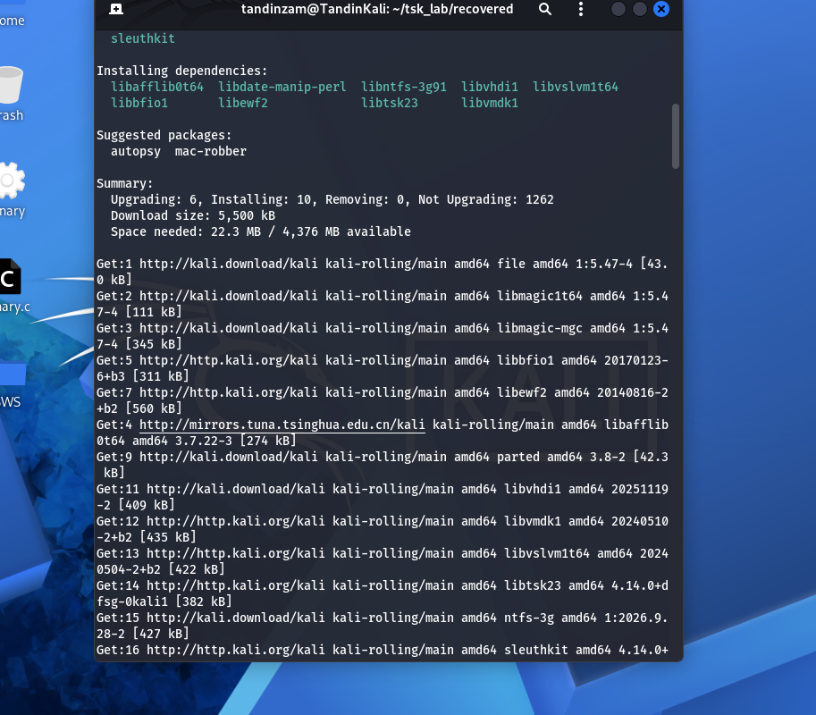

**Figure 2: Creating the make_files.py generator script**

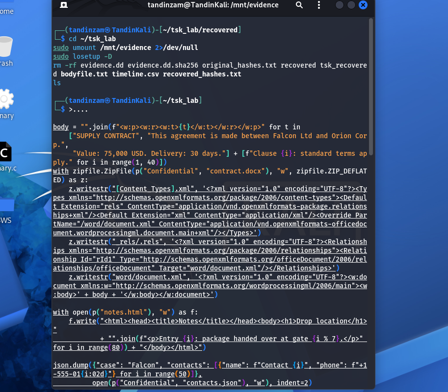

**Figure 3: Script saved (4232 bytes), then building the image, formatting it as NTFS and mounting it**

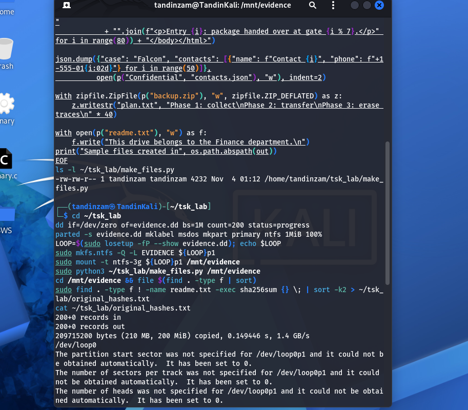

**Figure 4: Sample files created, file types confirmed and original SHA-256 hashes recorded**

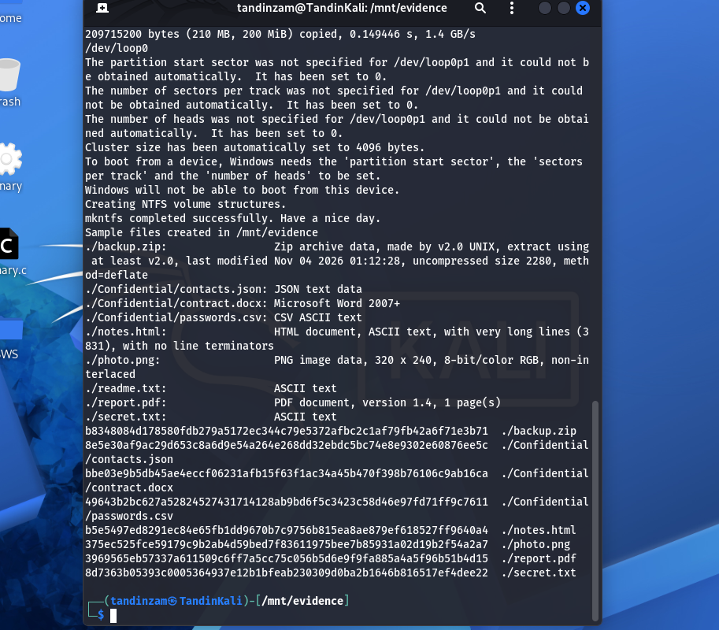

**Figure 5: Deleting the files, unmounting, hashing the image and making it read-only, then img_stat and mmls**

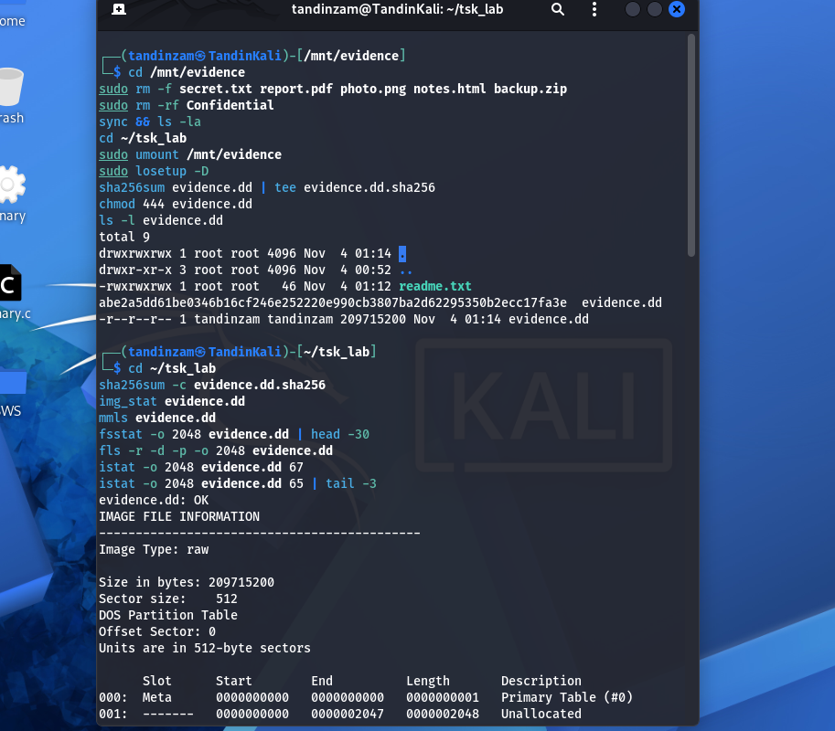

**Figure 6: fsstat output and fls listing all deleted files with their MFT entries**

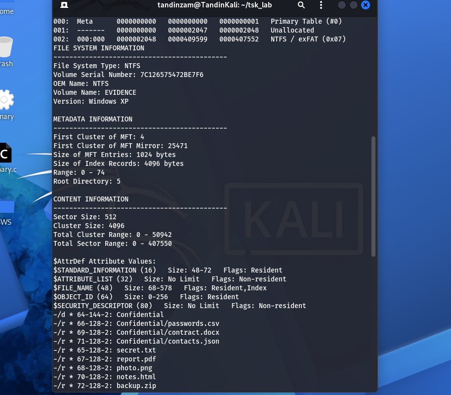

**Figure 7: istat on report.pdf (entry 67) showing Not Allocated File and its timestamps**

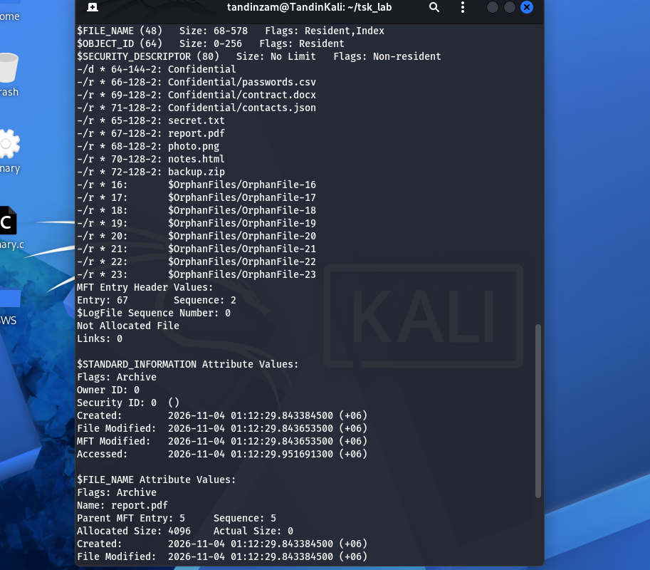

**Figure 8: istat attributes showing report.pdf is non-resident in cluster 25984 and secret.txt is resident (72 bytes)**

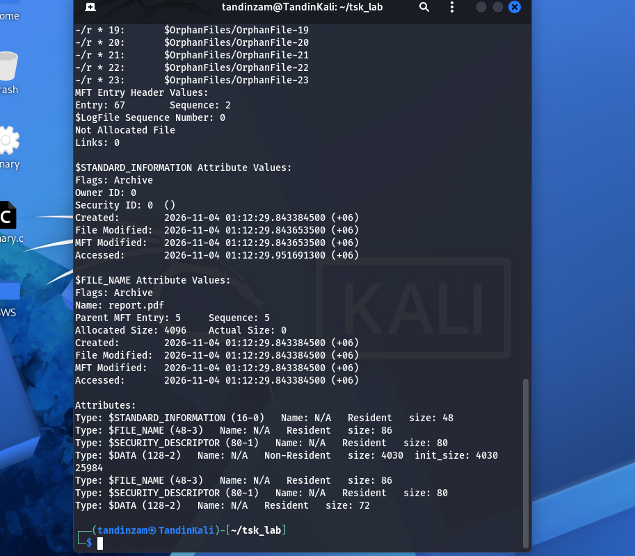

**Figure 9: Recovering all 8 files with icat and confirming their sizes and file types**

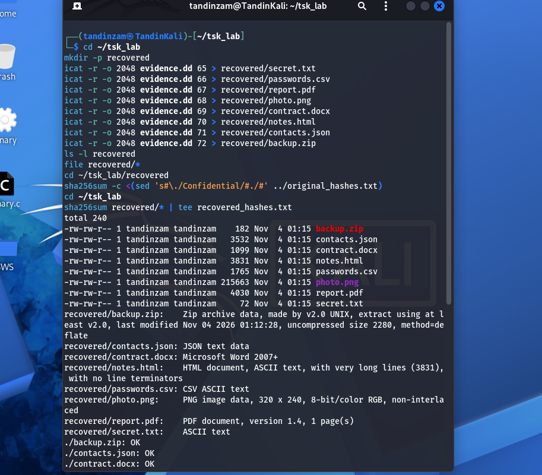

**Figure 10: All 8 recovered files pass the SHA-256 check, and the recovered hashes are saved**

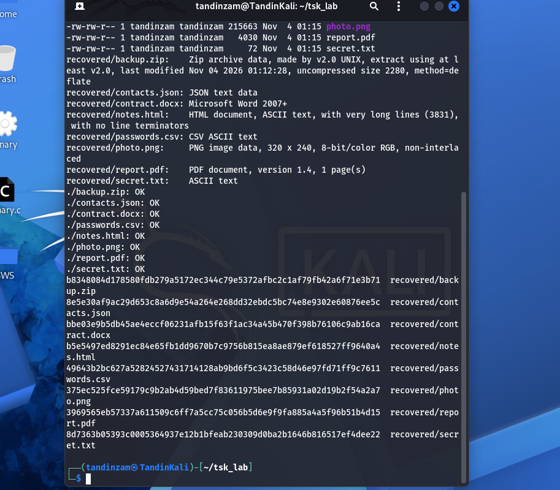

**Figure 11: tsk_recover bulk recovery (8 files, all OK), the mactime timeline and the final image hash check (evidence.dd: OK)**

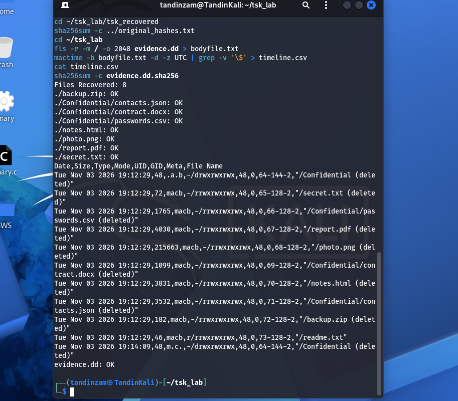